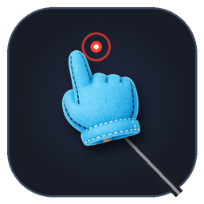
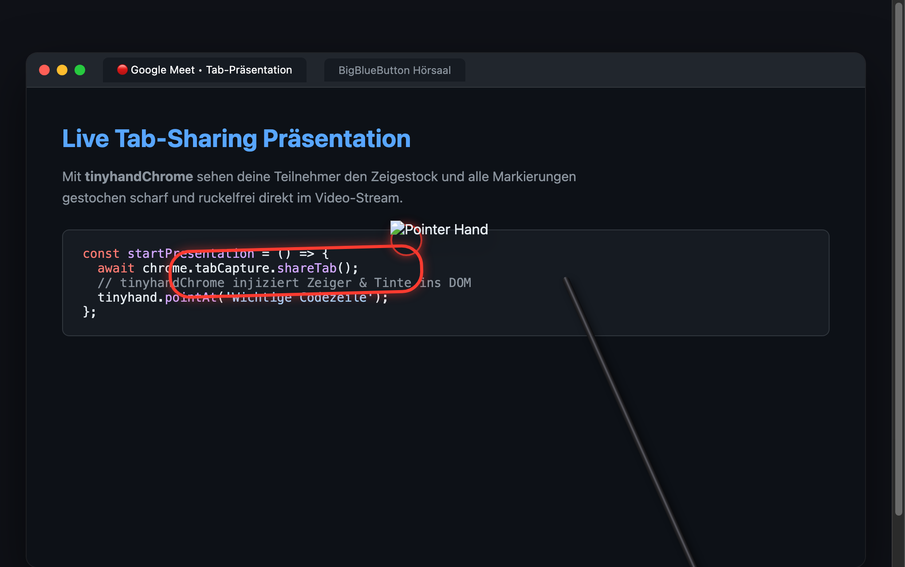

# tinyhandChrome

[](https://github.com/Schmitt-A/tinyhandChrome/releases)
[](https://github.com/Schmitt-A/tinyhandChrome)
[](https://developer.chrome.com/docs/extensions/mv3/intro/)
[](./LICENSE)

A tiny hand on a stick that points at things in your Chrome tabs during screen-sharing.  
*(Ein winziger Zeigestock mit Hand, der bei Tab-Bildschirmfreigaben in Google Chrome auf Dinge zeigt.)*
---

## 📸 Screenshots & Vorschau

### Live-Einsatz bei einer Tab-Präsentation (z. B. Google Meet oder BigBlueButton):


---

## 📌 Über das Projekt (About)

| GitHub-Feld | Empfohlener Inhalt (zum Kopieren für Repository-Settings) |
| :--- | :--- |
| **Description** | *Virtueller Zeigestock & verblassende Freihand-Tinte für Tab-Bildschirmfreigaben in BigBlueButton, Google Meet und Zoom.* |
| **Description (EN)** | *Virtual presenter pointer & ephemeral drawing ink for Chrome tab screen-sharing in BigBlueButton, Google Meet, and Zoom.* |
| **Website** | `https://github.com/Schmitt-A/tinyhandChrome` |
| **Topics / Tags** | `chrome-extension`, `manifest-v3`, `screen-sharing`, `presentation-tool`, `virtual-pointer`, `bigbluebutton`, `google-meet`, `zoom`, `teams`, `tinyhand`, `drawing-tool`, `education`, `remote-work` |

### Warum tinyhandChrome für Tab-Sharing?

Wenn du in **BigBlueButton (BBB)**, **Google Meet**, **Microsoft Teams** oder **Zoom** nicht deinen gesamten Desktop teilst, sondern aus Datenschutz- oder Performancegründen **nur einen einzelnen Browser-Tab**, werden native macOS-Overlay-Apps vom Tab-Stream ignoriert.

**tinyhandChrome löst dieses Problem elegant:**  
Die Erweiterung injiziert einen virtuellen Zeiger und eine transparente Zeichenebene direkt in das isolierte **Shadow DOM** des aktiven Web-Tabs. Dadurch wird der Zeiger **1:1 in den Video-Stream des geteilten Tabs übertragen** – deine Teilnehmer sehen den Zeigestock und alle Markierungen ruckelfrei und gestochen scharf!

---

## 🚀 Installation (macOS, Windows, Linux)

Funktioniert auf allen Betriebssystemen in Google Chrome sowie allen Chromium-Browsern (**Brave**, **Microsoft Edge**, **Vivaldi**, **Opera**).

### 1. Repository herunterladen
```bash
git clone https://github.com/Schmitt-A/tinyhandChrome.git tinyhandChrome
```
*(Alternativ: Oben auf GitHub auf **Code** ➔ **Download ZIP** klicken und den Ordner entpacken).*

### 2. In Chrome aktivieren
1. Öffne im Browser:
   ```text
   chrome://extensions
   ```
2. Aktiviere oben rechts den Schalter **„Entwicklermodus“** (*Developer mode*).
3. Klicke oben links auf **„Entpackte Erweiterung laden“** (*Load unpacked*).
4. Wähle den Ordner `tinyhandChrome` aus (den Ordner, der die `manifest.json` enthält).
5. Klicke auf das **Puzzleteil-Symbol** in der Chrome-Leiste und pinne **tinyhandChrome** an deine Menüleiste.

---

## ⌨️ Bedienung (Use)

| Tastenkürzel (macOS) | Tastenkürzel (Win / Linux) | Aktion |
| :--- | :--- | :--- |
| <kbd>⌥ Option</kbd> + <kbd>H</kbd> | <kbd>Alt</kbd> + <kbd>H</kbd> | **tinyhandChrome Ein / Aus** (Zeiger aktivieren oder verbergen) |
| <kbd>⌥ Option</kbd> + <kbd>F</kbd> | <kbd>Alt</kbd> + <kbd>F</kbd> | **Fokus-Spotlight Ein / Aus** (dunkelt Umgebung um den Zeiger ab) |
| <kbd>⌥ Option</kbd> + <kbd>C</kbd> | <kbd>Alt</kbd> + <kbd>C</kbd> | **Zeichnungen leeren** (Löscht sofort alle Markierungen) |
| <kbd>⌥ Option</kbd> + <kbd>S</kbd> | <kbd>Alt</kbd> + <kbd>S</kbd> | **Favoriten-Stilwechsel** (wechselt durch deine `★`-Favoriten) |
| <kbd>⇧ Shift</kbd> + **Maus ziehen** | <kbd>Shift</kbd> + **Maus ziehen** | **Zeichnen & Markieren** (Freihand, Pfeil oder Rahmen; Standard ~3s Fade) |
| <kbd>⌘ Cmd</kbd> + <kbd>Z</kbd> | <kbd>Ctrl</kbd> + <kbd>Z</kbd> | **Rückgängig** (Entfernt die letzte Zeichnung / Markierung) |
| **Links / Rechts / Doppelklick** | **Links / Rechts / Doppelklick** | Normale Seitenbedienung + unterscheidbares Klick-Ripple-Feedback |

> [!TIP]
> Tastenkombinationen können jederzeit im Popup über **„Tastenkombinationen anpassen ⚙️“** oder direkt unter `chrome://extensions/shortcuts` frei belegt werden.

---

## ✨ Features

- 👆 **36 authentische 3D-Zeigerstile + Durchsuchbare Bild-Galerie:**  
  Große visuelle Miniatur-Galerie mit Suche und Kategorien (*Klassik*, *Material*, *Kreativ*) sowie **individuellen `★`-Favoriten** für den Schnellwechsel per <kbd>Alt+S</kbd>. Enthält u. a. Lavender Toy (Standard), Plush Mitt, Robot Hand, Coral Vinyl, Cursor Glove, Cactus, Wood, Astronaut, Chrome, Holo, Marble, Terrazzo, Monster, Neon, Pixel, Skeleton sowie den minimalistischen **Laser-Dot**.

- 🔦 **Fokus-Spotlight-Modus (<kbd>Alt+F</kbd>):**  
  Dunkelt auf Knopfdruck die übrige Webseite weich ab und hebt einen hellen Lichtkreis um den Zeiger hervor – mit stufenlosem Fokus-Radius (`80–340 px`) und Abdunklung (`15%–85%`). Zeichnungen bleiben dabei voll leuchtend.

- ✍️ **Präsentations-Zeichenwerkzeuge & Rückgängig:**  
  - Wählbare Formen: **Freihand**, **Pfeil** (mit sauberer Spitze) und **Markierungsrahmen** (abgerundetes Highlight-Rechteck).
  - **Rückgängig (<kbd>Cmd/Ctrl+Z</kbd> / <kbd>Alt+Z</kbd>)** und Direkt-Buttons (*Rückgängig*, *Alles leeren*) direkt im Popup.
  - Auslöser wählbar (<kbd>Shift</kbd>, <kbd>Alt</kbd> oder *Immer bei Klick*), 5 Neon-Presets + Farbpicker, 3 Strichstärken und Verblassdauer (2s, 3s, 5s oder dauerhaft).

- 🎯 **Eigene Zeiger hochladen, Spiegeln & Dual-Kalibrierung:**  
  PNG-, SVG- oder WebP-Grafiken bis 2 MB hochladen (übergroße Rasterbilder werden beim Upload automatisch auf max. 512 px optimiert). Im Kalibrierfeld lassen sich sowohl die **Klickspitze** als auch der **Stab-Ansatz** exakt justieren und die Grafik bei Bedarf **horizontal spiegeln**.

- 🪄 **Rechtwinklige Stabgeometrie, wählbare Stab-Optik & Metallmanschette:**  
  - Exakt rechtwinklig (90°) zur Manschette ausgerichteter 3D-Zeigestab mit realistischer **Metall-/Farbmanschette (Ferrule)**.
  - Frei wählbares Stab-Material (*Auto passend zum Zeiger*, *Carbon*, *Holz & Messing*, *Lack-Weiß & Silber*, *Gebürstetes Aluminium*).
  - 6 Verankerungs-Modi: *Unten rechts / links (mitwandernd)*, *Dynamisch mittig*, *Feste Ecke rechts / links* oder *Frei schwebend* (-60° bis +60°).

- 💥 **Konfigurierbares Klick-Feedback:**  
  Visuelle Unterscheidung von **Linksklick**, **Rechtsklick** (amberfarben gestrichelter Ring) und **Doppelklick** (Doppelwelle) – jederzeit im Popup an- oder abschaltbar.

- ⚡ **Sofort aktiv ohne Tab-Reload & Iframe-Unterstützung:**  
  Bereits vor der Installation oder einem Update geöffnete Tabs werden automatisch injiziert – kein F5 nötig. Dank Koordinaten-Bridge funktioniert der Zeiger auch über eingebettete `<iframe>`-Präsentationen hinweg (z. B. eingebettete Slides oder PDFs).

- 🌐 **Website-Automatik & Mehrsprachigkeit:**  
  Domains wie `meet.google.com` mit einem Klick für den Auto-Start vormerken. Zweisprachige Oberfläche (Deutsch & Englisch über Chrome `_locales`), dynamische Anzeige deiner echten Tastenkürzel aus Chrome sowie Ein-Klick-Reset auf Standardwerte.

- 🛡️ **Geschlossenes Shadow DOM & 100% Datenschutz:**  
  Alle Overlay-Elemente laufen isoliert in einem geschlossenen (`closed`) Shadow DOM ohne Seiteneffekte. Alles läuft rein lokal im Browser – keine Analytik, kein Tracking, keine externen Anfragen.

---

## 📄 Lizenz & Danksagung

- **Konzept & Zeiger-Assets:** Basiert auf dem fantastischen Open-Source-Projekt [TinyHand für macOS von nilbuild (Kamran Ahmed)](https://github.com/nilbuild/tinyhand).
- Entwickelt als eigenständige, plattformunabhängige Browser-Erweiterung für Web-Screen-Sharing auf **macOS**, **Windows** und **Linux**.
- Lizenziert unter der [MIT License](LICENSE).
