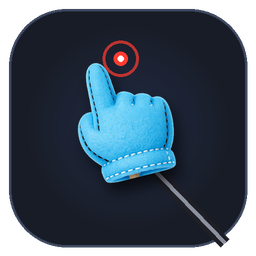
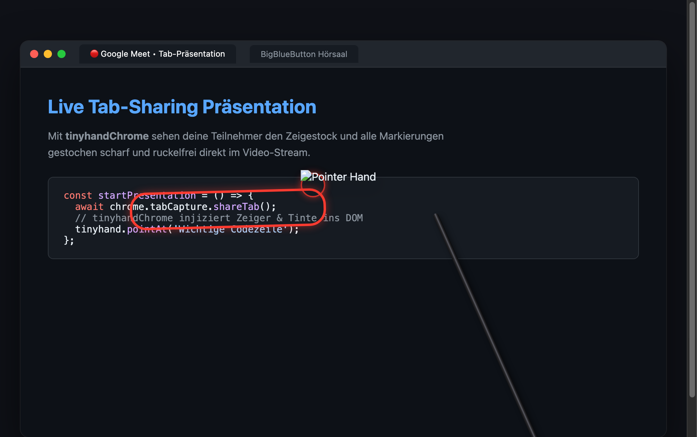

# tinyhandChrome

[](https://github.com/Schmitt-A/tinyhandChrome/releases)
[](https://github.com/Schmitt-A/tinyhandChrome)
[](https://developer.chrome.com/docs/extensions/mv3/intro/)
[](./LICENSE)

A tiny hand on a stick that points at things in your Chrome tabs during screen-sharing.  
*(Ein winziger Zeigestock mit Hand, der bei Tab-Bildschirmfreigaben in Google Chrome auf Dinge zeigt.)*
---

## 📸 Screenshots & Vorschau

### Live-Einsatz bei einer Tab-Präsentation (z. B. Google Meet oder BigBlueButton):


---

## 📌 Über das Projekt (About)

| GitHub-Feld | Empfohlener Inhalt (zum Kopieren für Repository-Settings) |
| :--- | :--- |
| **Description** | *Virtueller Zeigestock & verblassende Freihand-Tinte für Tab-Bildschirmfreigaben in BigBlueButton, Google Meet und Zoom.* |
| **Description (EN)** | *Virtual presenter pointer & ephemeral drawing ink for Chrome tab screen-sharing in BigBlueButton, Google Meet, and Zoom.* |
| **Website** | `https://github.com/Schmitt-A/tinyhandChrome` |
| **Topics / Tags** | `chrome-extension`, `manifest-v3`, `screen-sharing`, `presentation-tool`, `virtual-pointer`, `bigbluebutton`, `google-meet`, `zoom`, `teams`, `tinyhand`, `drawing-tool`, `education`, `remote-work` |

### Warum tinyhandChrome für Tab-Sharing?

Wenn du in **BigBlueButton (BBB)**, **Google Meet**, **Microsoft Teams** oder **Zoom** nicht deinen gesamten Desktop teilst, sondern aus Datenschutz- oder Performancegründen **nur einen einzelnen Browser-Tab**, werden native macOS-Overlay-Apps vom Tab-Stream ignoriert.

**tinyhandChrome löst dieses Problem elegant:**  
Die Erweiterung injiziert einen virtuellen Zeiger und eine transparente Zeichenebene direkt in das isolierte **Shadow DOM** des aktiven Web-Tabs. Dadurch wird der Zeiger **1:1 in den Video-Stream des geteilten Tabs übertragen** – deine Teilnehmer sehen den Zeigestock und alle Markierungen ruckelfrei und gestochen scharf!

---

## 🚀 Installation (macOS, Windows, Linux)

Funktioniert auf allen Betriebssystemen in Google Chrome sowie allen Chromium-Browsern (**Brave**, **Microsoft Edge**, **Vivaldi**, **Opera**).

### 1. Repository herunterladen
```bash
git clone https://github.com/Schmitt-A/tinyhandChrome.git tinyhandChrome
```
*(Alternativ: Oben auf GitHub auf **Code** ➔ **Download ZIP** klicken und den Ordner entpacken).*

### 2. In Chrome aktivieren
1. Öffne im Browser:
   ```text
   chrome://extensions
   ```
2. Aktiviere oben rechts den Schalter **„Entwicklermodus“** (*Developer mode*).
3. Klicke oben links auf **„Entpackte Erweiterung laden“** (*Load unpacked*).
4. Wähle den Ordner `tinyhandChrome` aus (den Ordner, der die `manifest.json` enthält).
5. Klicke auf das **Puzzleteil-Symbol** in der Chrome-Leiste und pinne **tinyhandChrome** an deine Menüleiste.

---

## ⌨️ Bedienung (Use)

| Tastenkürzel (macOS) | Tastenkürzel (Win / Linux) | Aktion |
| :--- | :--- | :--- |
| <kbd>⌥ Option</kbd> + <kbd>H</kbd> | <kbd>Alt</kbd> + <kbd>H</kbd> | **tinyhandChrome Ein / Aus** (Zeiger aktivieren oder verbergen) |
| <kbd>⌥ Option</kbd> + <kbd>C</kbd> | <kbd>Alt</kbd> + <kbd>C</kbd> | **Zeichnungen leeren** (Löscht sofort alle Markierungen) |
| <kbd>⌥ Option</kbd> + <kbd>S</kbd> | <kbd>Alt</kbd> + <kbd>S</kbd> | **Schnell-Stilwechsel** (wechselt durch die Favoriten) |
| <kbd>⇧ Shift</kbd> + **Maus ziehen** | <kbd>Shift</kbd> + **Maus ziehen** | **Freihand zeichnen** (verblasst nach ca. 3s automatisch) |
| **Normaler Linksklick** | **Normaler Linksklick** | Normale Webseiten-Bedienung + Klick-Tap & Ripple-Effekt |

> [!TIP]
> Tastenkombinationen können jederzeit im Popup über **„Tastenkombinationen anpassen ⚙️“** oder direkt unter `chrome://extensions/shortcuts` frei belegt werden.

---

## ✨ Features

- 👆 **36 authentische 3D-Zeigerstile:**  
  Umfangreiche Galerie hochwertiger Zeigerhände direkt aus TinyHand: Lavender Toy (Standard), Plush Mitt, Robot Hand, Coral Vinyl, Cursor Glove, Desert Cactus, Turned Wood, Astronaut, Midnight, Sky, Chocolate, Chrome, Cloud, Gingerbread, Fuzzy, Glass, Grass, Holo, Jelly, Knit, Lava, Leaf, Lemon, Low Poly, Marble, Mech, Mint, Monster, Cyber Neon, Pastel, Bubblegum Pink, 8-Bit Pixel, Spooky Skeleton, Space, Terrazzo, Water sowie ein minimalistischer **Laser-Dot** Präsentationspunkt.

- 🎯 **Eigene Zeiger hochladen & Live-Kalibrierung:**  
  Lade beliebige eigene PNG-, SVG- oder WebP-Grafiken als Zeiger hoch. Dank der interaktiven **Fadenkreuz-Kalibrierung** im Einstellungsmenü lässt sich die genaue Position der Fingerspitze bzw. des Klickpunkts millimetergenau justieren.

- 📐 **Rechtwinklige Stabgeometrie (90°):**  
  Der Zeigestab tritt stets exakt senkrecht und zentriert in die Handmanschette ein – kein krummes oder schiefes Aufsitzen mehr bei schrägen Fingerwinkeln.

- 🪄 **Vier flexible Verankerungs-Modi:**
  - **Unten rechts (Ecke):** Klassischer Referenten-Zeigestock aus der rechten unteren Bildschirmecke.
  - **Unten links (Ecke):** Zeigestock aus der linken unteren Bildschirmecke.
  - **Dynamisch von unten:** Die Basis wandert am unteren Bildschirmrand mit dem Cursor mit und neigt sich organisch mit der Mausbewegung.
  - **Frei schwebend:** Hand ohne langen Stab mit stufenlos einstellbarem Grundneigungswinkel (-60° bis +60°) und automatischer Bewegungsneigung.

- 📏 **Stufenlose Skalierung & 3D-Tiefe:**
  - **Zeigergröße (60 – 320 px):** Frei stufenlos anpassbar für jede Bildschirmauflösung (Full HD, 4K, Ultrawide).
  - **Stabbreite (2 – 24 px):** Mathematisch konstante Stabbreite in allen Richtungen, Entfernungen und Winkeln.
  - **Schatten & 3D-Tiefe (0% – 100%):** Einstellbarer räumlicher Drop-Shadow für Hand und Stab.

- 🫁 **Natürliche Bewegungsdynamik & Atembewegung:**  
  Zwei feinfühlige Schieberegler für organische Bewegung:
  - **Trägheit & Bewegungsdynamik (0% – 200%):** Für geschmeidige, ruckelfreie Verfolgung des Cursors.
  - **Schweben & Atmen im Stillstand (0% – 200%):** Sanfte, lebendige Auf- und Abbewegung bei ruhender Maus.

- ✍️ **Verblassende Freihand-Tinte (Ephemeral Ink):**  
  Spontanes Zeichnen und Einkreisen wichtiger Inhalte direkt auf der Webseite:
  - Auslöser wählbar: <kbd>Shift</kbd> + Ziehen, <kbd>Alt</kbd> + Ziehen oder immer bei Klick.
  - 5 leuchtende Farb-Presets (Neon-Rot, Neon-Gelb, Neon-Grün, Cyan, Weiß) + unbegrenzter HTML5-Farbpicker.
  - 3 Strichstärken: Dünn (3px), Mittel (4px), Dick (7px).
  - Automatische Verblassdauer: 2s, 3s, 5s oder dauerhaft.
  - Sofortiges Leeren per Shortcut (<kbd>Alt+C</kbd> / <kbd>⌥+C</kbd>).

- 💥 **Klick-Tap & leuchtender Ripple-Halo:**  
  Jeder Klick löst eine sanfte Eintauch-Bewegung (Tap) der Hand und einen leuchtenden Puls-Effekt (Ripple) an der Fingerspitze aus.

- 👁️ **Mauszeiger-Steuerung:**  
  Optionales Verstecken des nativen Betriebssystem-Mauszeigers (`cursor: none`), sodass die Zuschauer ausschließlich die Zeigerhand sehen.

- 🛡️ **Isoliertes Shadow DOM (Zero Leaks):**  
  Alle Elemente laufen in einem geschlossenen Web Components Shadow DOM. Kein Webseiten-CSS kann die Darstellung stören, und es entstehen keinerlei Seiteneffekte auf den DOM-Baum der besuchten Website.

- ⚡ **Präsentationssicher:**  
  Fängt niemals die <kbd>Escape</kbd>-Taste ab – Vollbild-Präsentationen, Slideshows und Videoplayer bleiben uneingeschränkt bedienbar.

- ⌨️ **Frei anpassbare Shortcuts:**  
  Alle Tastenkombinationen können im Einstellungsmenü mit einem Klick in der systemweiten Chrome-Tastenverwaltung frei belegt werden.

- 🔒 **100% Datenschutz:**  
  Alle Berechnungen finden rein lokal im Browser statt. Keine Analytik, kein Tracking, keine externen Serveranfragen.

---

## 📄 Lizenz & Danksagung

- **Konzept & Zeiger-Assets:** Basiert auf dem fantastischen Open-Source-Projekt [TinyHand für macOS von nilbuild (Kamran Ahmed)](https://github.com/nilbuild/tinyhand).
- Entwickelt als eigenständige, plattformunabhängige Browser-Erweiterung für Web-Screen-Sharing auf **macOS**, **Windows** und **Linux**.
- Lizenziert unter der [MIT License](LICENSE).
