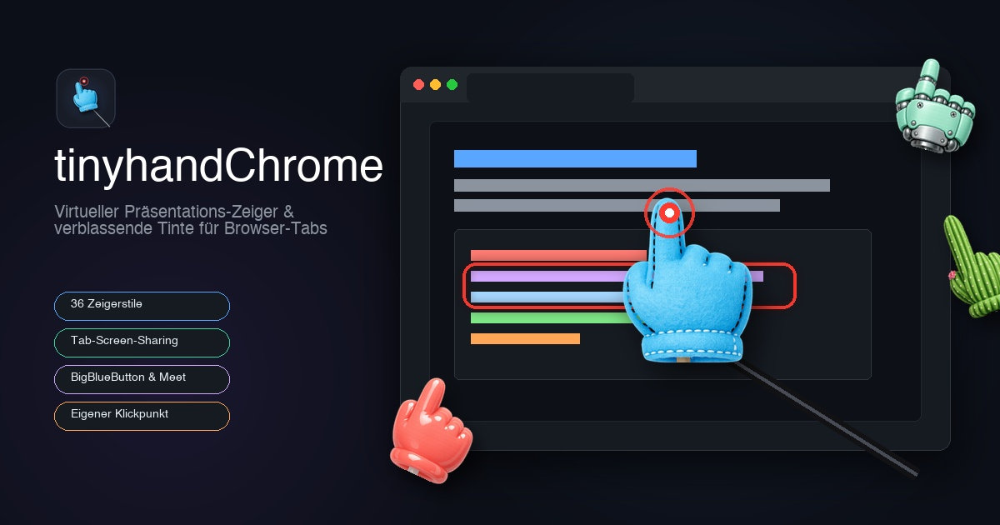
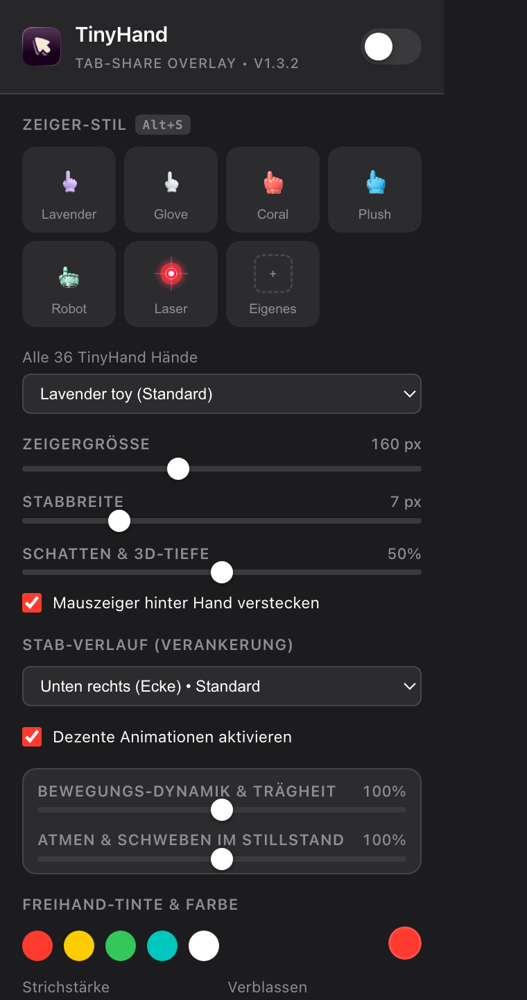
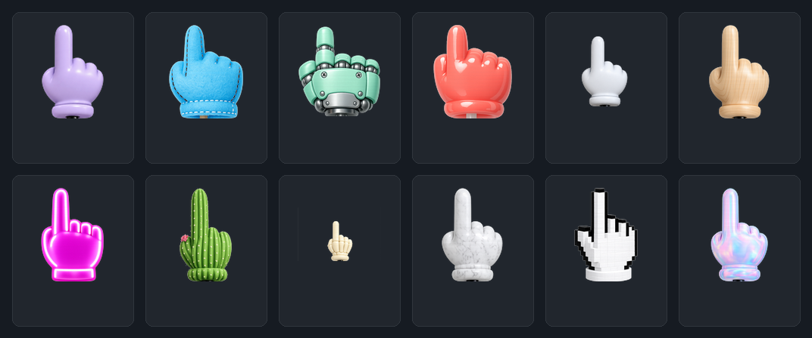

# tinyhandChrome

[](https://github.com/Schmitt-A/TinyHandChrome/releases)
[](https://github.com/Schmitt-A/TinyHandChrome)
[](https://developer.chrome.com/docs/extensions/mv3/intro/)
[](./LICENSE)

A tiny hand on a stick that points at things in your Chrome tabs during screen-sharing.  
*(Ein winziger Zeigestock mit Hand, der bei Tab-Bildschirmfreigaben in Google Chrome auf Dinge zeigt.)*



---

## 📸 Screenshots & Vorschau

### Live-Einsatz bei einer Tab-Präsentation (z. B. Google Meet oder BigBlueButton):


### Einstellungen-Popup & Stile-Katalog:
<p align="center">
  
  &nbsp;&nbsp;&nbsp;&nbsp;
  
</p>

---

## 📌 Über das Projekt (About)

| GitHub-Feld | Empfohlener Inhalt (zum Kopieren für Repository-Settings) |
| :--- | :--- |
| **Description** | *Virtueller Zeigestock & verblassende Freihand-Tinte für Tab-Bildschirmfreigaben in BigBlueButton, Google Meet und Zoom.* |
| **Description (EN)** | *Virtual presenter pointer & ephemeral drawing ink for Chrome tab screen-sharing in BigBlueButton, Google Meet, and Zoom.* |
| **Website** | `https://github.com/Schmitt-A/TinyHandChrome` |
| **Topics / Tags** | `chrome-extension`, `manifest-v3`, `screen-sharing`, `presentation-tool`, `virtual-pointer`, `bigbluebutton`, `google-meet`, `zoom`, `teams`, `tinyhand`, `drawing-tool`, `education`, `remote-work` |

### Warum tinyhandChrome für Tab-Sharing?

Wenn du in **BigBlueButton (BBB)**, **Google Meet**, **Microsoft Teams** oder **Zoom** nicht deinen gesamten Desktop teilst, sondern aus Datenschutz- oder Performancegründen **nur einen einzelnen Browser-Tab**, werden native macOS-Overlay-Apps vom Tab-Stream ignoriert.

**tinyhandChrome löst dieses Problem elegant:**  
Die Erweiterung injiziert einen virtuellen Zeiger und eine transparente Zeichenebene direkt in das isolierte **Shadow DOM** des aktiven Web-Tabs. Dadurch wird der Zeiger **1:1 in den Video-Stream des geteilten Tabs übertragen** – deine Teilnehmer sehen den Zeigestock und alle Markierungen ruckelfrei und gestochen scharf!

---

## 🚀 Installation (macOS, Windows, Linux)

Funktioniert auf allen Betriebssystemen in Google Chrome sowie allen Chromium-Browsern (**Brave**, **Microsoft Edge**, **Vivaldi**, **Opera**).

### 1. Repository herunterladen
```bash
git clone https://github.com/Schmitt-A/TinyHandChrome.git tinyhandChrome
```
*(Alternativ: Oben auf GitHub auf **Code** ➔ **Download ZIP** klicken und den Ordner entpacken).*

### 2. In Chrome aktivieren
1. Öffne im Browser:
   ```text
   chrome://extensions
   ```
2. Aktiviere oben rechts den Schalter **„Entwicklermodus“** (*Developer mode*).
3. Klicke oben links auf **„Entpackte Erweiterung laden“** (*Load unpacked*).
4. Wähle den Ordner `tinyhandChrome` aus (den Ordner, der die `manifest.json` enthält).
5. Klicke auf das **Puzzleteil-Symbol** in der Chrome-Leiste und pinne **tinyhandChrome** an deine Menüleiste.

---

## ⌨️ Bedienung (Use)

| Tastenkürzel (macOS) | Tastenkürzel (Win / Linux) | Aktion |
| :--- | :--- | :--- |
| <kbd>⌥ Option</kbd> + <kbd>H</kbd> | <kbd>Alt</kbd> + <kbd>H</kbd> | **tinyhandChrome Ein / Aus** (Zeiger aktivieren oder verbergen) |
| <kbd>⌥ Option</kbd> + <kbd>C</kbd> | <kbd>Alt</kbd> + <kbd>C</kbd> | **Zeichnungen leeren** (Löscht sofort alle Markierungen) |
| <kbd>⌥ Option</kbd> + <kbd>S</kbd> | <kbd>Alt</kbd> + <kbd>S</kbd> | **Schnell-Stilwechsel** (wechselt durch die Favoriten) |
| <kbd>⇧ Shift</kbd> + **Maus ziehen** | <kbd>Shift</kbd> + **Maus ziehen** | **Freihand zeichnen** (verblasst nach ca. 3s automatisch) |
| **Normaler Linksklick** | **Normaler Linksklick** | Normale Webseiten-Bedienung + Klick-Tap & Ripple-Effekt |

> [!TIP]
> Tastenkombinationen können jederzeit im Popup über **„Tastenkombinationen anpassen ⚙️“** oder direkt unter `chrome://extensions/shortcuts` frei belegt werden.

---

## ✨ Features

- 👆 **36 authentische Zeigerstile:** Lavender Toy (Standard), Plush Mitt, Robot Hand, Coral Vinyl, Cartoon Glove, Turned Wood, Desert Cactus, Cyber Neon, Spooky Skeleton, 8-Bit Pixel und viele mehr.
- 📏 **Stufenlose Größen- & Breiten-Regelung:**
  - **Zeigergröße (60 – 320 px):** Frei skalierbar.
  - **Stabbreite (2 – 24 px):** Konstante Stabbreite in allen Winkeln und Entfernungen.
  - **Schatten & 3D-Tiefe (0% – 100%):** Einstellbarer Drop-Shadow für Hand und Stab.
- 📐 **Rechtwinklige Stabverbindung (90°):** Der Stab tritt immer senkrecht mittig in die Handmanschette ein – kein krummes Aufsitzen bei schrägen Fingerhaltungen.
- 🪄 **Vier Verankerungs-Modi:**
  - **Unten rechts (Ecke):** Klassischer Referenten-Zeigestock aus der rechten unteren Ecke.
  - **Unten links (Ecke):** Aus der linken unteren Ecke.
  - **Dynamisch von unten:** Basis wandert unterhalb des Cursors mit sanfter organischer Neigung mit.
  - **Frei schwebend:** Hand ohne Stab mit stufenloser Zeiger-Neigung (-60° bis +60°) und Bewegungsdynamik.
- 🫁 **Regelbare dezente Animationen:** Getrennte Schieberegler für Bewegungs-Trägheit (Inertia) und Ruhe-Atmung (0% – 200%).
- 🎯 **Eigene Zeiger hochladen:** PNG/SVG-Upload mit interaktiver Klickpunkt-Kalibrierung per Fadenkreuz.
- ✍️ **Verblassende Freihand-Tinte:** Gezeichnete Linien blenden sich nach ca. 3 Sekunden sanft von selbst aus.

---

## 📦 Releases & Versionsverlauf (Changelog)

| Version | Highlights |
| :--- | :--- |
| **[v1.3.2](https://github.com/Schmitt-A/TinyHandChrome/releases/tag/v1.3.2)** *(Aktuell)* | **Eigenständiges Design:** Neues eigenes Icon & Banner. **Perfekte 90°-Stabausrichtung:** Senkrechter Stabeintritt in die Handmanschette ohne krummes Aufsitzen. **Gleichmäßige Stabbreite** in jeder Richtung. **Stabile Ecken-Verankerung** („Unten rechts“ & „Unten links“) mit Sofort-Umschaltung. |
| **v1.3.0** | **Klickpunkt-Kalibrierung:** Fadenkreuz-Picker für eigene PNG/SVG-Zeiger. **Stabbreite & 3D-Tiefe:** Stufenlos regelbar (2–24 px / 0–100%). **Frei schwebender Modus** mit Neigungswinkel (-60° bis +60°). **Feintuning:** Separate Schieberegler für Bewegungsträgheit & Atmen. |
| **v1.2.0** | Durchgehender Zeigestab direkt im Ärmel, stufenlose Zeigergröße (60–320 px), organische Atembewegung im Ruhezustand. |
| **v1.1.0** | Integration aller 36 Zeigerstile (Lavender, Plush, Robot, Coral, Glove, Cactus, Wood, etc.). |
| **v1.0.0** | Erstveröffentlichung: Virtueller Zeiger & verblassende Freihand-Tinte im isolierten Shadow DOM für Tab-Screen-Sharing. |

---

## 📄 Lizenz & Danksagung

- **Konzept & Zeiger-Assets:** Basiert auf dem fantastischen Open-Source-Projekt [TinyHand für macOS von nilbuild (Kamran Ahmed)](https://github.com/nilbuild/tinyhand).
- Entwickelt als eigenständige, plattformunabhängige Browser-Erweiterung für Web-Screen-Sharing auf **macOS**, **Windows** und **Linux**.
- Lizenziert unter der [MIT License](LICENSE).
